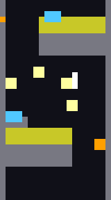

<p align="center">
  
</p>

[](https://www.python.org/)
[](https://github.com/MihaiStreames/Downwell.AI)
[](https://opensource.org/licenses/MIT)

DQN agent for [Downwell](https://store.steampowered.com/app/360740/Downwell/).



The agent plays the real game. A small GML script patched into `data.win` packs the game state into one buffer every step: the player and run state, plus every active instance the agent cares about (enemies, terrain, hazards, gems, pickups, its own shots). The Python side reads that state from process memory, holds keys to act, and wraps it all in a [Gymnasium](https://gymnasium.farama.org/) environment trained with Double DQN. The gif is what the agent sees: its observation grid at the end of an evaluation run that got down to 2-2.

## Requirements

- Downwell (Steam), Windows or Linux
- [uv](https://docs.astral.sh/uv/)
- [UndertaleModTool](https://github.com/UnderminersTeam/UndertaleModTool) to patch `data.win`
- An NVIDIA GPU is optional, training falls back to CPU

## Setup

Install dependencies:

```sh
uv sync
```

Patch the game (back up `data.win` first):

```sh
uv run python scripts/gen_export.py  # writes the gml and the injector to scripts/generated/
```

1. Open a clean `data.win` in UndertaleModTool
2. `Scripts > Run other script...` and pick `scripts/generated/InjectDQNExport.csx`
3. `File > Save`, then launch the game and start a run
4. `DOWNWELL_DATA_WIN="path/to/data.win" uv run python scripts/gen_ptrs.py` to point the reader at the patch's globals

Run the injector once on a clean `data.win`, it appends code. The snapshot layout lives in `downwell_ai/env/memory/layout.py`: the patch is generated from it and the reader parses with it. After changing it, regenerate, re-inject on a clean `data.win` and rerun `gen_ptrs.py`.

## Usage

Start the patched game (any screen, the agent takes over input and resets runs itself), then:

```sh
uv run downwell-train configs/default.toml                               # 1M steps, every field is required, see configs/README.md
uv run downwell-train configs/long_run.toml                              # the same over 2.5M steps
uv run downwell-train configs/full_run.toml                              # the same over 5M steps
uv run downwell-train configs/default.toml --rendered                    # keep drawing to watch the agent play
uv run downwell-train configs/default.toml --resume runs/<run>/model.pt  # keep training a model into a new run
```

Play a trained model (reads the run's `config.json` next to it):

```sh
uv run downwell-play runs/<run>/model.pt                           # watch 3 episodes at real game speed
uv run downwell-play runs/<run>/model.pt --episodes 20 --headless  # measure it as fast as possible
```

Plot training curves (written automatically when a run finishes):

```sh
uv run downwell-plot runs/<run>                 # plots.png in the run, with reward terms and hits
uv run downwell-plot runs/<run-a> runs/<run-b>  # overlay runs into runs/comparison.png
```

Each run writes to `runs/downwell-seed<seed>-<timestamp>/`:

| file            | contents                                                      |
| --------------- | ------------------------------------------------------------- |
| `config.json`   | the exact config used                                         |
| `training.log`  | lifecycle events, level clears, upgrades and hits             |
| `metrics.jsonl` | per-episode return, depth, reward terms and hits              |
| `plots.png`     | training curves, see `downwell-plot`                          |
| `eval-*.gif`    | periodic evaluation episodes, drawn from the agent's own view |
| `model.pt`      | weights of the best evaluation episode                        |

## How it works

The environment, reward and learning setup are being written up as a paper in [`docs/paper/main.typ`](docs/paper/main.typ) (TODO, a draft).

## Contributing

See [CONTRIBUTING.md](CONTRIBUTING.md).

## License

This project is licensed under the [MIT License](LICENSE).

<div align="center">
  Made with ❤️
</div>
